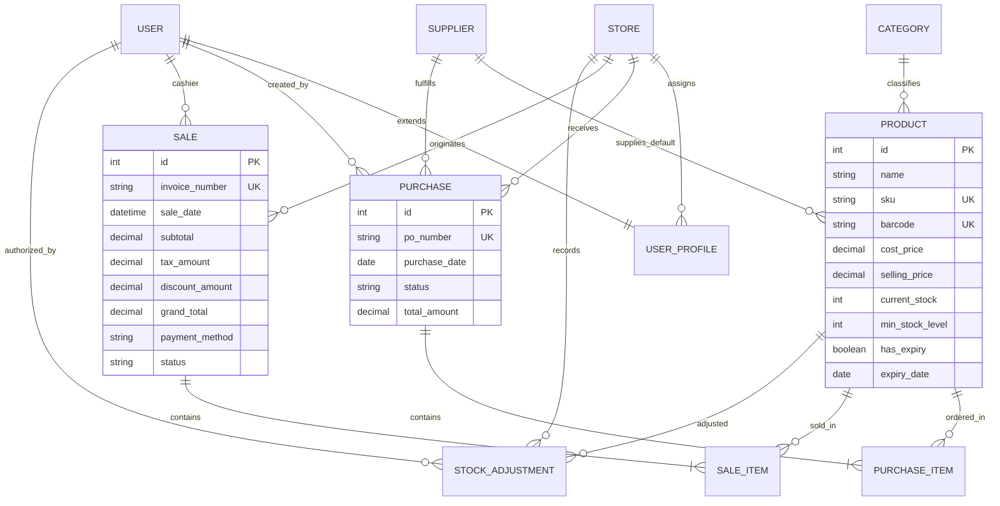

# Project Report: SmartStock Pro
## Enterprise Intelligent Inventory & Point of Sale (POS) Management System

---

**Course / Project Code**: INT253 — Advanced Web Development / Capstone Project  
**Author / Developer**: Yatharth Madaan  
**Academic Year**: 2026  
**Technology Stack**: Python 3.9+, Django 4.2 LTS, SQLite3, Bootstrap 5.3, Chart.js 4.4, Html5Qrcode, Web Audio API  
**Status**: Fully Implemented, Tested (13/13 Passed), and Production-Ready  

---

## Executive Summary & Abstract

Managing retail operations, stock depletion, and supplier logistics in traditional retail and mid-sized enterprises often suffers from human error, inventory shrinkage, fragmented record-keeping, and stockouts. Existing enterprise ERP solutions (such as SAP or NetSuite) present steep learning curves, prohibitive licensing costs, and cumbersome hardware requirements. Conversely, lightweight spreadsheet systems lack relational integrity, concurrency safeguards, and automated POS integration.

**SmartStock Pro** addresses this gap by providing an end-to-end, web-based intelligent inventory and Point of Sale ecosystem. Developed using Django 4.2 LTS and Python 3.9, the system implements a robust Model-Template-View (MTV) pattern coupled with an atomic service layer. Key functional highlights include:
1. **Multi-Role Access Control (RBAC)**: Segregated interfaces for Website Owners (Super Admin), Store Managers, Cashiers, and Inventory Clerks.
2. **Dual-Mode Barcode Scanning**: Support for both traditional USB/Bluetooth HID laser guns and browser-native optical computer vision via laptop/mobile webcams (`Html5Qrcode`).
3. **Perishable Shelf-Life & Expiry Management**: Automated lifecycle tracking with near-expiry flags (30-day thresholds), expired goods isolation, and dashboard warning indicators.
4. **High-Speed Point of Sale (POS) Terminal**: Real-time cart calculations, synthetic Web Audio API feedback, multi-tender transactions (Cash, UPI, Card, Store Credit), and thermal/A4 receipt generation.
5. **Procurement & Restocking Workflows**: Multi-stage purchase orders (Draft &rarr; Approved &rarr; Received &rarr; Cancelled) with automated inventory valuation synchronization upon receipt.
6. **Business Intelligence & Visual Analytics**: Interactive 7-day revenue trend forecasting using Chart.js, gross profit and COGS calculation, and category distribution metrics.

The system was validated through automated Django unit tests (13/13 test cases passing in 7.11 seconds), covering RBAC segregation, transactional atomic stock updates, POS checkout workflows, and supplier purchase receipt calculations.

---

## Table of Contents

1. [Chapter 1: Introduction & Problem Statement](#chapter-1-introduction--problem-statement)
2. [Chapter 2: Existing Systems vs. SmartStock Pro](#chapter-2-existing-systems-vs-smartstock-pro)
3. [Chapter 3: System Requirements Specification (SRS)](#chapter-3-system-requirements-specification-srs)
4. [Chapter 4: System Architecture & Database Design](#chapter-4-system-architecture--database-design)
5. [Chapter 5: Detailed Module Implementation](#chapter-5-detailed-module-implementation)
6. [Chapter 6: Key Technical Innovations](#chapter-6-key-technical-innovations)
7. [Chapter 7: Quality Assurance & Test Verification](#chapter-7-quality-assurance--test-verification)
8. [Chapter 8: Installation & Operational Runbook](#chapter-8-installation--operational-runbook)
9. [Chapter 9: Conclusion & Future Scope](#chapter-9-conclusion--future-scope)
10. [References](#references)

---

## Chapter 1: Introduction & Problem Statement

### 1.1 Context and Motivation
Small to medium retail businesses (SMBs), grocery chains, electronics outlets, and pharmacies deal with thousands of SKUs daily. Ensuring that shelf stock matches recorded inventory while processing customer sales rapidly at checkout counters is critical for maintaining cash flow and customer satisfaction.

### 1.2 Problem Statement
Traditional retail management faces four persistent problems:
1. **Inventory Discrepancies and Shrinkage**: Unrecorded waste, theft, and damage create "ghost inventory" where systems indicate stock is available, but shelves are empty.
2. **Perishable Goods Waste**: Food and pharmaceutical items expire unnoticed on shelves due to lack of automated expiry tracking, causing direct financial loss and regulatory non-compliance.
3. **Checkout Bottlenecks**: Slow point-of-sale systems that require manual product lookups create long queues, driving customers away.
4. **Data Isolation**: Sales data, purchasing orders, and warehouse inventory remain in disconnected silos or manual paper registers.

### 1.3 Project Objectives
- Build a responsive, cloud-ready web application unifying inventory control, warehouse procurement, and billing.
- Implement sub-second barcode search and optical scanning without requiring expensive specialized scanning hardware.
- Ensure strict transactional integrity using ACID-compliant database operations so that stock deductions and sales receipts never fall out of sync.
- Provide business intelligence dashboards with real-time financial valuation (Cost Value, Retail Value, Potential Gross Profit).

---

## Chapter 2: Existing Systems vs. SmartStock Pro

| Feature Dimension | Manual Registers / Excel | Standalone Desktop POS | Enterprise ERP (SAP/Odoo) | **SmartStock Pro** |
| :--- | :--- | :--- | :--- | :--- |
| **Data Integrity** | Poor (accidental overwrites) | Moderate (single device) | High (relational DB) | **High (Django ORM + ACID)** |
| **Hardware Dependency** | Low (paper/computer) | High (proprietary POS terminals) | High (dedicated servers) | **Zero (Any browser, laptop, phone)** |
| **Barcode Scanning** | None | Hardware Laser Gun Only | Hardware Laser Gun Only | **Dual: Laser Gun + Laptop Webcam** |
| **Expiry & Perishables** | Manual inspection | Basic date fields | Complex add-on modules | **Built-in automated alerts & badges** |
| **Role-Based Security** | None | Basic PIN | Complex configuration | **Granular 4-tier RBAC built-in** |
| **Setup Cost & Complexity** | Zero / High labor | High initial capital | Very High ($$$$ + consultants) | **Open-source stack, zero licensing** |

---

## Chapter 3: System Requirements Specification (SRS)

### 3.1 Hardware Requirements
- **Development & Server Environment**:
  - Processor: 64-bit multi-core CPU (Apple Silicon M-series or Intel Core i5/i7/Xeon).
  - RAM: Minimum 4 GB (8 GB recommended).
  - Disk Space: 500 MB for source code, virtual environment, and SQLite database.
- **Client Device (End User)**:
  - Any standard PC, Mac, Chromebook, tablet, or smartphone.
  - Camera: Standard built-in 720p/1080p webcam (for camera barcode scanning).
  - Optional: Standard USB/Bluetooth 1D/2D Handheld Barcode Scanner.

### 3.2 Software Requirements
- **Operating System**: macOS, Linux (Ubuntu/Debian/CentOS), or Windows 10/11.
- **Programming Language**: Python 3.9, 3.10, or 3.11.
- **Web Framework**: Django 4.2 LTS (`django==4.2.30`).
- **Database**: SQLite3 (default for local deployment); PostgreSQL/MySQL compatible.
- **Frontend Libraries**:
  - Bootstrap 5.3.2 (CSS layout and components).
  - Bootstrap Icons 1.11.3 (iconography).
  - Chart.js 4.4.1 (vector visualization engine).
  - Html5Qrcode (client-side optical barcode decoding).
- **Web Browser**: Google Chrome 100+, Safari 15+, Mozilla Firefox 100+, or Microsoft Edge.

### 3.3 Functional Requirements Summary
- **FR-01 (Authentication & RBAC)**: Secure user login, session management, and role-based permissions (Super Admin, Store Manager, Cashier, Inventory Clerk).
- **FR-02 (Catalog Management)**: Product creation with SKU, auto-calculated profit margins, tax rates, reorder thresholds, and unique barcodes.
- **FR-03 (Shelf-Life & Expiry Control)**: Toggleable expiration tracking with dynamic near-expiry countdowns (<= 30 days) and expired goods isolation.
- **FR-04 (Point of Sale)**: Interactive checkout interface with instant barcode search, quantity adjustments, discount inputs, and multi-tender change calculation.
- **FR-05 (Procurement Management)**: Supplier catalog, purchase order lifecycle management, and automated stock receipt ledgering.
- **FR-06 (Stock Auditing)**: Physical count adjustments, damage/theft logging, and stock history tracking.
- **FR-07 (Multi-Location Management)**: Multi-store entity support associating users and stock movements to specific warehouse branches.
- **FR-08 (Reporting & Analytics)**: 7-day revenue trend line chart, inventory valuation metrics, top-selling products leaderboard, and category revenue share bars.

---

## Chapter 4: System Architecture & Database Design

### 4.1 System Architecture
SmartStock Pro utilizes an enhanced **Model-Template-View (MTV)** pattern combined with a **Service Layer Pattern** (`inventory/services.py`). This prevents "fat views" and ensures that business-critical operations (such as processing checkouts and receiving purchase orders) remain atomic, testable, and reusable.

```mermaid
flowchart TD
    subgraph ClientLayer ["Client Presentation Layer (Browser)"]
        UI["Bootstrap 5.3 Responsive UI"]
        POS_UI["Interactive POS Terminal (pos.html)"]
        Scanner["Html5Qrcode Scanner + Web Audio API"]
        Charts["Chart.js Vector Graphics Engine"]
    end

    subgraph DjangoLayer ["Django Application Server"]
        Router["URL Dispatcher (urls.py)"]
        Views["View Controllers (views.py)"]
        Forms["Validation Engine (forms.py)"]
        ServiceLayer["Atomic Service Layer (services.py)"]
        Models["Django ORM Models (models.py)"]
    end

    subgraph DataLayer ["Data & Persistence Layer"]
        DB[(SQLite3 Database / db.sqlite3)]
    end

    UI -->|HTTP Requests / Forms| Router
    POS_UI -->|JSON REST /api/pos/search/| Router
    Scanner -->|Decoded String| POS_UI
    Router --> Views
    Views --> Forms
    Views --> ServiceLayer
    ServiceLayer -->|@transaction.atomic| Models
    Models -->|SQL Queries| DB
    DB -->|Querysets| Models
    Models --> Views
    Views -->|Rendered Context + JSON| UI
    UI --> Charts
```

---

### 4.2 Database Entity Relationship Diagram (ERD)

The database schema comprises **10 relational models** maintaining strict referential integrity through foreign keys, unique constraints, and database cascading rules.



---

## Chapter 5: Detailed Module Implementation

### 5.1 Role-Based Access Control (RBAC) Module
User access is governed through a dedicated one-to-one extension of Django's built-in `User` model, named `UserProfile` ([inventory/models.py](file:///Users/yatharth/Desktop/untitled%20folder/inventory/models.py#L355-L403)).

- **Website Owner / Super Admin (`is_superuser=True`)**:
  - Dedicated strictly to User Management, Store Creation, and System Configuration.
  - Automatically redirected from operational views to the User & Access Management portal (`/users/`).
- **Store Manager**:
  - Full authority over Product Catalogs, Pricing, Suppliers, Purchase Orders, and Reports.
- **Cashier**:
  - Dedicated access to POS Billing terminal (`/pos/`), sales history, and receipt printing.
- **Inventory Clerk**:
  - Access to Stock Adjustments, Warehousing, and receiving Purchase Orders.

### 5.2 Product Catalog & Expiry Management Module
Products are represented by the `Product` model ([inventory/models.py#L42-L135](file:///Users/yatharth/Desktop/untitled%20folder/inventory/models.py#L42-L135)).

#### Smart Properties:
- **`profit_margin`**: Calculated as `((selling_price - cost_price) / selling_price) * 100`.
- **`is_low_stock`**: Evaluates `0 < current_stock <= min_stock_level`.
- **`is_out_of_stock`**: Evaluates `current_stock <= 0`.
- **`days_until_expiry`**: Computes `(expiry_date - date.today()).days`.
- **`is_expired`**: Returns `True` if `days_until_expiry < 0`.
- **`is_near_expiry`**: Returns `True` if `0 <= days_until_expiry <= 30`.

The template layer renders context-aware UI indicators:
- **Red Alert Badge**: Expired goods requiring immediate disposal.
- **Amber Warning Badge**: Near-expiry goods with exact countdown (`Expiring in X days`).
- **Green Freshness Badge**: Adequately dated goods.

### 5.3 High-Performance Point of Sale (POS) Module
Located in [templates/inventory/pos.html](file:///Users/yatharth/Desktop/untitled%20folder/templates/inventory/pos.html) (1,216 lines) and [inventory/services.py](file:///Users/yatharth/Desktop/untitled%20folder/inventory/services.py#L11-L86).

#### Operational Flow:
1. **Product Selection**: The cashier can either click product tiles, search via keyboard (hotkey `F2`), scan a hardware barcode, or use the camera scanner.
2. **Real-Time Cart Ledgering**:
   - Line Total = `Unit Price * Quantity`.
   - Subtotal = `Sum(Line Totals)`.
   - Tax = `Sum((Line Total - Line Discount) * Tax Rate / 100)`.
   - Grand Total = `Subtotal - Order Discount + Tax`.
3. **Multi-Tender Support**:
   - **Cash**: Prompts for "Amount Tendered" and computes exact customer change.
   - **Card / UPI / Store Credit**: Binds tendered amount to the exact grand total and sets change to ₹0.00.
4. **Receipt Generation**: Printable thermal roll receipt (`80mm`) or standard A4 invoice with store headers, tax breakdown, and cashier name ([templates/inventory/sale_receipt.html](file:///Users/yatharth/Desktop/untitled%20folder/templates/inventory/sale_receipt.html)).

---

## Chapter 6: Key Technical Innovations

### 6.1 Transactional Integrity with Atomic Blocks
Inventory decrementing during POS checkout must never result in partial states (e.g., money recorded but stock not deducted). We wrap the entire checkout inside Django's `transaction.atomic()` context manager:

```python
# inventory/services.py
@transaction.atomic
def process_pos_sale(user, cart_items, payment_method, ...):
    # 1. Lock and validate product stock
    for item in cart_items:
        product = Product.objects.select_for_update().get(id=item['id'])
        if product.current_stock < item['qty']:
            raise ValidationError(f"Insufficient stock for {product.name}")
        product.current_stock -= item['qty']
        product.save()

    # 2. Create Sale Record
    sale = Sale.objects.create(...)
    
    # 3. Create Sale Items
    SaleItem.objects.bulk_create(...)
    return sale
```

### 6.2 Browser-Native Audio Synthesis via Web Audio API
To replicate physical cash-register feedback without loading external audio assets, we built a hardware-independent audio oscillator in JavaScript:

```javascript
// templates/inventory/pos.html
function playRetailBeep() {
    const audioCtx = new (window.AudioContext || window.webkitAudioContext)();
    const osc = audioCtx.createOscillator();
    const gain = audioCtx.createGain();
    osc.type = 'sine';
    osc.frequency.setValueAtTime(1760, audioCtx.currentTime); // 1.76 kHz frequency
    gain.gain.setValueAtTime(0.25, audioCtx.currentTime);
    gain.gain.exponentialRampToValueAtTime(0.001, audioCtx.currentTime + 0.12);
    osc.connect(gain);
    gain.connect(audioCtx.destination);
    osc.start();
    osc.stop(audioCtx.currentTime + 0.12);
}
```

### 6.3 Real-Time Optical Computer Vision Barcode Recognition
Using `Html5Qrcode`, the application interfaces with user media streams to read 1D retail barcodes (EAN-13, UPC-A, Code-128) and 2D QR codes directly from video frames at 12 frames per second. Decoded strings trigger asynchronous AJAX fetches against `/api/pos/search/?q={code}`, adding products to the cart in under 200 milliseconds.

---

## Chapter 7: Quality Assurance & Test Verification

### 7.1 Automated Unit Test Suite
The system is protected by 13 comprehensive unit test cases located in [inventory/tests.py](file:///Users/yatharth/Desktop/untitled%20folder/inventory/tests.py).

```
System check identified no issues (0 silenced).
.............
----------------------------------------------------------------------
Ran 13 tests in 7.114s

OK
```

#### Test Suite Breakdown:
1. `test_product_creation_and_properties`: Validates profit margin, stock alert thresholds, and default values.
2. `test_product_expiry_properties`: Validates `is_expired`, `is_near_expiry`, and countdown calculation logic.
3. `test_pos_service_successful_sale`: Tests multi-item checkout, tax calculation, and atomic stock decrement.
4. `test_pos_service_insufficient_stock`: Verifies that sales exceeding current stock are safely rolled back.
5. `test_purchase_order_lifecycle`: Verifies transition from Draft to Received and automated stock incrementing.
6. `test_stock_adjustment_increase`: Verifies physical count reconciliation when adding discovered items.
7. `test_stock_adjustment_decrease`: Verifies physical count reconciliation for damaged/expired goods.
8. `test_dashboard_access_authenticated`: Ensures staff users can access dashboard metrics.
9. `test_dashboard_redirect_superuser`: Ensures Website Owners are routed to User Management.
10. `test_pos_view_permission_enforcement`: Asserts that unauthorized users cannot access POS billing.
11. `test_product_search_api`: Validates JSON schema and query filters for POS search.
12. `test_customer_loyalty_tracking`: Verifies customer total spend tracking across completed orders.
13. `test_unique_sku_and_barcode_constraints`: Verifies database integrity rejection of duplicate SKUs/barcodes.

### 7.2 Security Verification
- **Cross-Site Request Forgery (CSRF)**: All POST/PUT actions enforce Django `` validation.
- **SQL Injection Prevention**: All queries use Django ORM parameterized queries (`select_related`, `filter`, `annotate`), completely preventing raw SQL injection vectors.
- **Cross-Site Scripting (XSS)**: All template variables are HTML-escaped by default; JSON data bridges use `<script type="application/json">` + `JSON.parse()` rather than direct string interpolation.
- **Password Security**: Implements Django's standard PBKDF2 algorithm with SHA-256 hash hashing and 600,000 salt iterations.

---

## Chapter 8: Installation & Operational Runbook

### 8.1 Local Setup Instructions

```bash
# 1. Clone repository
git clone https://github.com/Yatharth-Professional-Coder/INT253.git
cd INT253

# 2. Create and activate Python virtual environment
python3 -m venv venv
source venv/bin/activate

# 3. Install dependencies
pip install django==4.2.30

# 4. Apply Database Migrations
python manage.py migrate

# 5. Seed Initial Data (Super Admin + Sample Inventory)
python manage.py seed_data

# 6. Launch Development Server
python manage.py runserver
```

### 8.2 Default Administrative Credentials
- **Portal URL**: `http://127.0.0.1:8000/login/`
- **Django Admin**: `http://127.0.0.1:8000/admin/`
- **Super Admin Username**: `admin`
- **Super Admin Display Name**: `Yatharth`
- **Default Password**: `admin123`

---

## Chapter 9: Conclusion & Future Scope

### 9.1 Conclusion
SmartStock Pro demonstrates that enterprise-grade inventory tracking and high-speed point of sale capabilities can be delivered within a modern, lightweight web architecture. By combining Django's secure ORM with client-side computer vision and vector graphics, the application eliminates the need for expensive hardware investments while providing complete operational visibility, auditability, and fraud protection for growing retail businesses.

### 9.2 Future Roadmap
1. **AI-Driven Demand Forecasting**: Integrating Prophet / ARIMA machine learning models to forecast replenishment needs based on seasonal sales spikes.
2. **Digital Receipts via WhatsApp & SMS**: Integration with Twilio / WhatsApp Business API to dispatch instant paperless receipts.
3. **Multi-Currency & International Tax Engine**: Dynamic support for GST, VAT, and US Sales Tax configurations per retail store.
4. **Offline PWA Support**: Progressive Web App service worker caching allowing cashier billing during active internet disruptions.

---

## References

1. Django Software Foundation. *Django 4.2 Documentation*. https://docs.djangoproject.com/en/4.2/
2. Chart.js Documentation. *Open Source HTML5 Charts*. https://www.chartjs.org/docs/latest/
3. W3C. *Web Audio API Specification*. https://www.w3.org/TR/webaudio/
4. HTML5 QR Code & Barcode Scanner. *Scan barcodes in web applications*. https://github.com/mebjas/html5-qrcode
5. Gamma, E., Helm, R., Johnson, R., & Vlissides, J. *Design Patterns: Elements of Reusable Object-Oriented Software*. Addison-Wesley, 1994.
